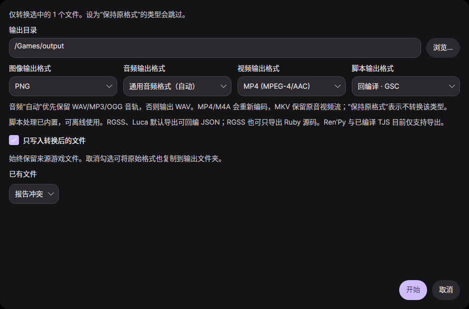
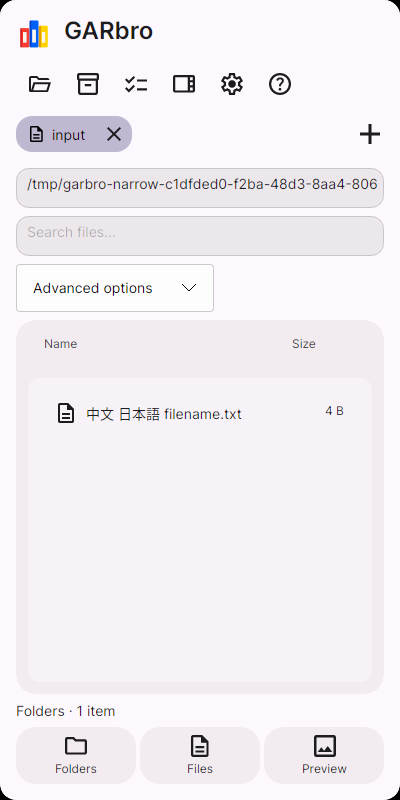

# Native script codecs and .NET 11

The development tree after 1.1.1 uses SDK 11.0.100 / runtime 11.0.0. Script processing is managed code: no Python, Ruby, Go, Rust runtime or separately installed compiler is required. Executable wrapper detection/removal is outside GARbro; there is no tool-download page. These changes do not alter the published 1.1.1 assets.

| Input | Built-in export | Built-in compilation |
|---|---|---|
| GSC | TSC | TSC → GSC |
| BGI / BPD | BSD / BPD | BSD / BPD → original binary family |
| Artemis ASB | Existing structured JSON array | JSON → ASB |
| NScripter / Utage | TXT | TXT → NSCRIPT / DSM |
| RGSS Scripts (XP / VX / VX Ace) | Single `.rgss.json`, or Ruby source with `--to RB` | JSON → original `.rxdata` / `.rvdata` / `.rvdata2` |
| Luca `SCRIPT.PAK` | Single `.luca.json` using a game scheme | JSON → complete `SCRIPT.PAK`, with relocated jumps |
| Ren’Py `.rpyc` / `.rpymc` | RPY / RPYM | Export only |
| TJS2100 | TJS through Furikiri Core | Export only |

`GARbro.Scripting` contains pure managed F# parsing and format transformations. File ownership, bounded staging, cancellation, worker supervision and atomic output commit remain in the application. Sources are UTF-8 or BOM-marked Unicode; target encodings use strict fallback. Auto is CP932 for GSC/BGI/NScripter, UTF-8 for ASB; DSM's encoding and cryptographic parameters are fixed by its format. Sources and previous output survive a failed conversion. Fixed output names are checked for collisions before GUI batch conversion.

## Compatibility and provenance

- GSC is independently implemented from the binary field layouts and [TSC format reference](https://github.com/Love-in-idleness/LiarsoftTool/blob/master/docs/GSC_OPCODE_REFERENCE.en.md). No GPL implementation is copied into this MIT project. Supports modern-36 / legacy-28, the six published instruction schemas, labels, VM operands, strings, data blocks and named-entry trailer relocation. Unknown layouts export a checksummed raw envelope; that fallback is preservation, not editable dialogue. Recognized source metadata is retained; stale encoding comments do not override the explicit target encoding.
- BGI/BPD ported from [Bgi_asdisEN](https://github.com/Checkumeito/Bgi_asdisEN/tree/44574e627093899efa9fb4b9b82d78e03fdfe447) (MIT, Daniel Wu, 2025). The embedded opcode table includes its standard aliases and mapping names; [license](licenses/Bgi_asdisEN.txt). Supports inline strings, raw string bytes, imports/exports/padding, labels and the published BPD variable-operand families. External `#string_table` is deliberately rejected rather than reading arbitrary paths; merge it into a self-contained BSD first. Engine-specific unknown instruction lengths are rejected.
- ASB uses the existing full JSON array of labels and command objects (`name`, `line_number`, `attributes`), matching the public Artemis ASB wire layout described by [msg-tool](https://github.com/lifegpc/msg-tool/blob/master/src/scripts/artemis/asb.rs). This is an independent BCL implementation, without Lua formatting or execution. It does not accept dialogue-only exports or compile Lua source to VM bytecode.
- NScripter uses the existing XOR codec; UTAGE DSM uses AES-256-CBC / PKCS7 with the existing PBKDF2-SHA1 parameters, preserving the original format.
- RGSS reads a bounded Ruby Marshal data subset without instantiating Ruby objects. JSON preserves script IDs, order, names, encoding and the original template. Editing one shared source string does not change other entries. All entries must remain present; unchanged JSON returns the original bytes. Ruby-only export is for reading, not roundtrip compilation.
- Luca follows [LuckSystem](https://github.com/wetor/LuckSystem/tree/8146592658f61cd4016464fa67da6348c6bbc3af) (MIT). Eleven game profiles are ordinary `LucaScheme` records under `LUCA-SCRIPT` in database 149: AIR, ButterflysPoisonBC, CartagraHD, HARMONIA, KANON, LOOPERS, LUNARiA, PlanetarianSG, SP, SummerPocketsRB and LB_EN. [SchemeTool data and generation](../SchemeTool/Data/SOURCE.md) keep existing groups and GameMap intact. Unsupported opcodes, missing branch layouts, unresolved targets or edits changing parameter structure reject modified output. No plugins are executed. Profiles specify covered layouts, not verified support for every edition of a game.
- Ren’Py uses a bounded Pickle **data** reader and native F# AST emitter, referencing [unrpyc](https://github.com/CensoredUsername/unrpyc/tree/3ae8334ed71a05535927dcc559663d3aca51215b) (MIT/BSD notices retained). It never imports or invokes Python constructors or executes source expressions. RPC2 and old zlib containers are accepted; dialogue, labels, calls, menus, Python source, ATL, SL2 screens, styles, translation and common testcase nodes are supported. Unknown nodes, custom displayables and unsupported testcase options fail explicitly. Obfuscated containers and Python bytecode-only code are outside this implementation. Authored fixtures cover protocols 2 and 5; Ren’Py 8.5.3 SDK examples compile after export. This does not establish exhaustive Ren’Py 6/7 compatibility.
- TJS2100 uses the pinned, dynamically linked LGPL-3.0 [Furikiri Core](../third_party/Furikiri/SOURCE.md), with input count checks. Its CLI, native runtimes and tools are excluded. Source reconstruction inherits Furikiri's bytecode coverage; unknown or malformed bytecode fails inside the supervised worker. No TJS compiler is claimed.

```sh
garbro convert Scripts.rvdata2 -o Scripts.rvdata2.rgss.json
garbro convert Scripts.rvdata2.rgss.json -o Scripts.rvdata2 --to RGSS
garbro convert Scripts.rvdata2 -o scripts.rb --to RB
garbro convert SCRIPT.PAK -o SCRIPT.PAK.luca.json --scheme LOOPERS
garbro convert SCRIPT.PAK.luca.json -o SCRIPT.PAK --to LUCA
garbro convert script.rpyc -o script.rpy
garbro convert script.tjs -o readable.tjs
```

Choose **Script output format → Export** in the GUI for these defaults, **Ruby source** for RGSS source only, or RGSS/LUCA for JSON compilation. Missing game parameters use the existing resource-scoped options dialog and retry path. Keep a separate output directory. JSON templates are data and are validated before the atomic output commit.

Synthetic [compatibility fixtures](../tests/fixtures/scripts-native/README.md) were compiled with independent tools. Those tools are development oracles only and are absent from application/package dependencies. The compatibility range is the implemented wire layouts; a successful conversion does not prove that a game engine accepts a new encoding.

## Builds

Android remains a separate project, so desktop builds do not install mobile workloads. Android 12+ ARM64/x64 APKs use the same UI and a bound decoder service. ReadyToRun is disabled for Android: CoreCLR builds otherwise hit the upstream [binding rewrite failure](https://github.com/dotnet/android/issues/11025); managed IL retains every decoder and avoids the extra native-code payload. The Android workflow runs one x64 emulator smoke pass, then builds architecture-specific packages. APK publication requires persistent signing credentials; development artifacts use temporary keys.

Store builds pin runtime/ILLink 11.0.0. The Wayland compatibility package remains pinned to its original SDK 10.0.403 and net10.0 assembly identity, consumed unchanged by .NET 11. Flatpak uses a checksummed, build-only official SDK 11.0.100 archive because no dotnet11 SDK extension is published yet; the SDK is removed during cleanup. Offline NuGet generation resolves with the same SDK in the Freedesktop sandbox.

Focused [CI 43884214985](https://github.com/Love-in-idleness/GARbro-lazer/actions/runs/43884214985) passed 36 codec/encoding/worker/packing checks, the four-language conversion layout check and the Linux desktop build. Real Avalonia/Skia renders were inspected in Russian and Chinese; the artifact contains all four languages. Follow-up checks cover the C-string encoding guard. Local test dependency copying stopped when disk space ran out; validation moved to CI. No macOS tests are scheduled.


The final four-column output selector passed [UI validation 43887536229](https://github.com/Love-in-idleness/GARbro-lazer/actions/runs/43887536229), including the no-conversion option and four languages. Script export/recompile is selected in the same row as image/audio/video formats; narrow layouts wrap automatically.



The .NET 11 Store build and shared-payload startup checks passed in [43885255368](https://github.com/Love-in-idleness/GARbro-lazer/actions/runs/43885255368). The side-load MSIX install/upgrade/file-activation/uninstall checks passed in [43885714267](https://github.com/Love-in-idleness/GARbro-lazer/actions/runs/43885714267). These are development artifacts; no release assets were changed.


Android 12/API 31 x64 emulator validation passed in [job 133374380837](https://github.com/Love-in-idleness/GARbro-lazer/actions/runs/43888883127/job/133374380837): shared browser, IPC extraction, text/PNG previews, manual PCM audio, cancellation, SAF access/conflicts/revocation, native ASB roundtrip and all 22 archive writers. The workflow was then cancelled only to avoid building superseded packages; its successful test job and diagnostic artifact remain available. This exposed and fixed double pipe closure, odd PCM buffer sizes and Android-owned directory aliases; child symlink checks remain enabled.

Final [UI validation 43891230042](https://github.com/Love-in-idleness/GARbro-lazer/actions/runs/43891230042) passed three checks, including a 400 px browser that keeps filenames readable by hiding the type column. The same responsive code is used on Windows, Linux and Android.



Final APKs use source commit `6ae73a4dbcf544e1d61e5205aa7729a16ecef5aa`, built in [43891237292](https://github.com/Love-in-idleness/GARbro-lazer/actions/runs/43891237292) without repeating the completed emulator check:

- [ARM64 development APK and SHA-256](https://github.com/Love-in-idleness/GARbro-lazer/actions/runs/43891237292/artifacts/14237087450)
- [x64 development APK and SHA-256](https://github.com/Love-in-idleness/GARbro-lazer/actions/runs/43891237292/artifacts/14235799835)

Both package jobs passed the ABI/package checks, `zipalign -P 16` and `apksigner verify`. They use temporary development signatures; a persistent publication key is still required for update-compatible public Android releases. No new GitHub Release was published. The emulator ran x64; ARM64 was built and checked, not executed on a real device. Full Flatpak offline builds and macOS tests were not run for this change. The known independent Wayland rebuild hash mismatch remains as documented in the previous release; the shipped compatibility package is unchanged.

## Native import validation — 2026-11-17

[CI 44028144418](https://github.com/Love-in-idleness/GARbro-lazer/actions/runs/44028144418)
passed 54 focused codec/database/worker checks, three GUI checks, seven public
CLI conversions and the desktop/SchemeTool builds. The tests exercise source
preservation, unchanged and edited RGSS templates, shared Marshal strings,
resource-scoped Luca scheme retry, eleven profiles, independently checked local
and cross-entry jumps, unsafe Pickle constructor rejection and damaged TJS count
handling without replacing a previous output. Ren’Py's authored export was also
compiled by the independent 8.5.3 SDK after the return-label fix.

Android ARM64 compiled the shared codecs in
[job 133851684688](https://github.com/Love-in-idleness/GARbro-lazer/actions/runs/44027633911/job/133851684688).
It was not rebuilt for test-assertion and packaging-check corrections. The new
codecs were not executed on an Android device. Windows execution and a full
Flatpak offline build were not repeated; the offline source generator does
discover the new Superpower dependency. No macOS tests or new release packaging
were run.

All four language catalogs contain the same 693 keys and checked placeholders.
Actual Avalonia/Skia screenshots were inspected in English, Chinese, Russian and
Japanese, including wrapped descriptions and visible action buttons; the
four-language conversion screenshots in `docs/screenshots` were updated.

The changed managed components and database add **784,854 bytes** over the public
1.1.1 Linux x64 package. Including Furikiri's compressed corresponding source,
the measured component increase is **1,036,303 bytes (0.99 MiB)**. This comparison
does not include small notice/dependency-manifest changes and is not a full
Store download/installation measurement. No Python/Ruby/Go runtime, game SDK or
external script executable is bundled. Exact scope, source commits, artifact
checksum and per-component sizes are in the
[validation record](validation/native-script-imports.json).
